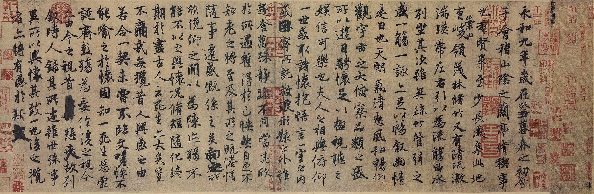

## Welcome to my homepage!
Updates on my research and expository papers, discussion of open problems, and other maths-related topics. *Last updated on October 27, 2026*

### About Me
Hi, I'm Yijie Miao (Chinese Name: 苗祎杰, Wade-Giles romanization: Miao I-chieh), a student in [the Department of Mathematics at Southeast University](https://math.seu.edu.cn/). I like puzzles, manga, Chinese chess, Go, and tennis.

天降工位（东南大学九龙湖校区人文社科综合楼 5楼 5A-9-18），友友们可以找我聊天 or 出去玩.
<!-- I have conducted some research on gradient estimates in general metric spaces and nonlinear equations under different geometric flows. Simultaneously, I have also gained in-depth knowledge and understanding of parabolic equations under curvature flows, the Moser iteration method, and improvements to gradient estimation methods based on integral curvature. -->

最近想学习阅读一些 Geometric Measure Theory, Spectral Geometry and Scalar Curvture 方面的内容.

##### 谱几何选用的教材是首师大 hzl 学长推荐的两本：[Topics in Spectral Geometry](/notes/Spectral_geometry/TSG230529.pdf) 和 [GTM 276](/notes/Spectral_geometry/functional-analysis-spectral-theory-applications-einsiedler-ward.pdf).
-----

“在碌碌无为和激动人心之间徘徊, 然后艰难曲折地前行, 是大部分研究者的心态.”

<!-- 该如何描述我对基础数学的感觉呢? 我想会是深沉而执着的, 并非浅尝辄止的. 它就像徒步者对山川的眷恋, 在踏遍每一寸土地后, 心中燃起了征服珠穆朗玛峰的雄心. 我无意于四处流连, 也无心于沿途风景, 只愿将全部心血毫无保留地倾注于此, 以此作为叩开那扇通往数学圣殿的庄严大门的唯一钥匙. -->

*“由于部分文件较大, 页面可能需要一些时间加载, 可以先冲一杯咖啡耐心等待, 感谢您的理解与支持！”*
### Notes
* [Functional Analysis — Lecture Notes of Zuoqin Wang](notes/functional-analysis.pdf): My TeX edition of Professor Zuoqin Wang's 2015 course notes, including exercises and solutions.
* [Laplace Eigenvalues and Pólya's Conjecture](notes/laplace-eigenvalues-polya-conjecture.pdf): My notes from Professor Zuoqin Wang's short course on spectral theory, Weyl's law, and Pólya's conjecture.
* [Geometry and Topology Seminar](https://geometry-topology.github.io/) This seminar aims at topics in the areas of Quantitative Topology and Quantitative Geometry, Metric Topology and Metric Geometry, Simplicial Volume and Bounded Cohomology, Topological Complexity, Hyperbolic Geometry, Geometric Topology, Coarse Geometry and K-theory, Differential Geometry and related subjects. Organizers: [Lizhi Chen (Lanzhou University)](https://sites.google.com/site/chenzhmath) and [Bo Zhu (YMSC, Tsinghua University)](https://sites.google.com/view/bozhumath/)
* [Introduction to Partial Differential Equations](notes/pde_by_Miao.pdf): My notes from Professor Jianchun Chu's introductory course on second-order elliptic PDEs.
* [Modes of Convergence](notes/some_tools/convergence-relations-on-finite-measure-spaces.pdf): Notes on convergence relations on finite measure spaces.
* [LaTeX Formula-Writing Tips](notes/some_tools/latex-formula-writing-tips.pdf): Tips for writing mathematical formulas more efficiently.
* [Ordinary Differential Equations](notes/O.D.E/O.D.E.pdf): My undergraduate course notes.
* [Mathematical Analysis III](notes/MA/MAIII.pdf): My course notes.
* [Complex Analysis](notes/complex_analysis/complex_analysis.pdf): My undergraduate course notes.
* [Real Analysis Exercises](notes/real_analysis/real_analysis_exercises.pdf): Selected exercises from Junxiang Xu's course, compiled by me.

##### 2025 Summer School
8月线上参加北京国际数学研究中心举办的微分几何暑期学校, 笔记如下：
* [二阶线性椭圆型偏微分方程选讲 by 李奇睿](notes/pde.pdf)
* [黎曼几何 by 王雨生](notes/rg.pdf)
* [复几何初步 by 韩骥原](notes/complexgeometry.pdf)

##### 2025 Nov. Online Mini-course 
* [Online Mini-course: Convergence of Riemannian Manifolds with Lower Scalar Curvature Bounds](https://math.lzu.edu.cn/info/1065/5583.htm) 

##### 2026 Mar. Nanjing University Mini-courses
* [Optimal transport and curvature-dimension theory by Bangxian Han](notes/Optimal_transport_and_curvature_dimension_theory.pdf) 
* [Rigidity of non-compact manifolds with nonnegative pinched curvature by Man Chun Lee](notes/Rigidity_of_Noncompact_Mnfd_With_Nonnegative_Piched_Curvature_%20Man_Chun_Lee.pdf)
* [Spectrum asympotically hyperbolic manifolds by Fang Wang](notes/Spectrum_for_asymptotically_hyperbolic_manifolds.pdf) 

As my understanding of the content covered in these three presentations is not comprehensive, my notes likely contain numerous errors or instances of misunderstanding. If anyone identifies any mistakes or wishes to discuss these topics with me, please feel free to reach out via email. Thank you.

##### 2026 Summer School

6月底参加国家天元数学东南中心与厦门大学举办的微分几何暑期学校, 笔记如下:
* [Introduction to harmonic maps by Xin Zhou](/notes/Lecture_notes_summer_2026/introduction-to-harmonic-maps-xin-zhou.pdf)
* [Minimal cones and asymptotic conic minimal surfaces by Zhihan Wang](/notes/Lecture_notes_summer_2026/minimal-cones-asymptotic-conic-minimal-surfaces-zhihan-wang.pdf)
* [Regularity of Minimal surfaces, and Bernstein-type problems by Nick Edelen](/notes/Lecture_notes_summer_2026/regularity-minimal-surfaces-bernstein-problems-nick-edelen.pdf)
* [Submanifolds in collapsing Einstein manifolds by Ruobing Zhang](/notes/Lecture_notes_summer_2026/submanifolds-collapsing-einstein-manifolds-ruobing-zhang.pdf)

6月底-7月中旬参见南京大学数学学院“几何分析学术年”活动 2026 几何分析暑期学校, 笔记如下：
* [二阶椭圆型偏微分方程及应用 by 刘佳堃](/notes/Lecture_notes_summer_2026/second-order-elliptic-pde-liu-jiakun.pdf)
* [热核估计 by 张振雷](/notes/Lecture_notes_summer_2026/heat-kernel-estimates-zhang-zhenlei.pdf)
* [Volume of Kähler-Einstein Fano Varieties by 李驰](/notes/Lecture_notes_summer_2026/volume-kahler-einstein-fano-varieties-li-chi.pdf)

8月初参加北京国际数学研究中心举办的微分几何暑期学校, 笔记如下：
* [二阶线性椭圆型偏微分方程选讲 by 邱国寰](/notes/Lecture_notes_summer_2026/second-order-linear-elliptic-pde-guohuan-qiu.pdf)
* [黎曼几何 by 邓宇星](/notes/Lecture_notes_summer_2026/riemannian-geometry-deng-yuxing.pdf)
* [复几何初步 by 傅鑫](/notes/Lecture_notes_summer_2026/complex-geometry-fu-xin.pdf)

------
### Research
#### Preprints
[Yijie Miao and Bin Shen. Shi-type and Hamilton-type gradient estimates for a general parabolic equation under compact Finsler CD(−K,N). arXiv:2506.14776.](https://arxiv.org/abs/2506.14776) A lot of modifications have been made so far.

#### Pubilications

[Yijie Miao and Bin Shen. Two Methods of Gradient Estimates for the Lichnerowicz Equation and Their Comparison. Taiwanese J. Math. Advance Publication 1 - 26, 2026.](https://doi.org/10.11650/tjm/260401)

-----

#### 这里记录了我对一些数学问题的随想, 并非详尽的笔记(很多为我在阅读文献的过程中整理和推导的总结, 截至本次更新并没有上传)

* [Minkowski Problem]()
* [Gromov-Hausdorff limit of Kähler manifolds and the finite generation conjecture by Gang Liu]()
* [Positive Mass Theorem I]()
* [Positive Mass Theorem II]()
* [Ricci Soliton]()
<!--
* [Aleksandrov-Bakelman-Pucci estimates]()
* [Nash-Moser Iteration Method]()
* [The Schauder Estimate]()
* [Ricci Flow]()

* [Capillary hypersurface]()
* [Yau's conjectures]()
* [Gradient estimates for the heat equation]()
* [积分曲率条件下的梯度估计问题(在图上是否仍能类似考虑)]()
* [球丛上的共形变换与Yamabe问题]()

-->
### Resources
<!--In the spirit of open-source learning, this space serves as a collective archive for mathematical excellence. I welcome submissions of exceptional course notes and resources—help us fill the gaps or provide new insights for fellow students and researchers.-->

本专栏旨在收录整理各类高质量的数学课程资源, 涵盖本科、研究生课程, 以及部分专题研讨会和精选的在线课程(中科大的孙天阳学长整理了更多内容, 已附上链接, 这里更多的是我学习过或想了解的内容). 后续与链接相关内容的个人学习心得与整理将更新至此, 以便回顾与查阅. 这个专栏的成长离不开大家的支持. 如果你在学习过程中发现了任何优秀的课程（本校、外校、网络）, 都欢迎投稿给我. 让我们一起, 把这里变成一个汇集精华学习资源的宝地！再次感谢同学们的支持, 更要感谢所有讲授课程的老师们！(如有侵权或不宜上传的内容, 请及时邮件联系, 谢谢！)

#### Equation
* [2020年春微分方程IIH(麻希南)](https://tysunseven.github.io/video/Differential_Equation_2020.html)
* [2020年BIMSA夏Introduction to partial differential equations(美国西北大学 楚健春)](https://www.bilibili.com/video/BV1iK4y1a74q/?spm_id_from=333.1387.favlist.content.click&vd_source=649e15088a359d76e6ba174c16e74de8)

#### Analysis
* [2022年春实分析(殷浩)](https://tysunseven.github.io/video/Real_Analysis_2022.html)
* [2025年复分析(刘思齐)](https://www.bilibili.com/video/BV13Bw9eeEtP/?spm_id_from=333.1387.favlist.content.click&vd_source=649e15088a359d76e6ba174c16e74de8)
* [Real Analysis 2020-2021 ICTP](https://www.bilibili.com/video/BV1x34y1y7SS/?spm_id_from=333.1387.favlist.content.click)

#### Algebra
* [抽象代数Ⅱ by Ph.D Matthew Salomone](https://www.bilibili.com/video/BV1vu411d71Y/?spm_id_from=333.1387.favlist.content.click&vd_source=649e15088a359d76e6ba174c16e74de8)
* [2021年代数数论](https://www.bilibili.com/video/BV1e54y1a7dY/?spm_id_from=333.1387.favlist.content.click&vd_source=649e15088a359d76e6ba174c16e74de8)
* [2022年秋BIMSA 同调代数导论(谢尔盖·伊万诺夫)](https://www.bimsa.cn/zh-CN/research_detail/IntHomAlg.html)
* [2025年春BIMSA Introduction to Lie algebras(阮宸炜)](https://www.bimsa.net/activity/InttoLiealg/)
* [2025年春BIMSA同调代数(袁北彗)](https://www.bimsa.net/activity/AninttoHomAlg/)
* [王崧《代数群介绍》](https://www.bilibili.com/video/BV1KB4y1m7DY/?spm_id_from=333.1387.favlist.content.click&vd_source=649e15088a359d76e6ba174c16e74de8)
* [同调代数UCLA](https://www.bilibili.com/video/BV1TE7Gz6ENj/?spm_id_from=333.1387.favlist.content.click&vd_source=649e15088a359d76e6ba174c16e74de8)
* [伽罗瓦理论(Richard E Borcherds) ](https://www.bilibili.com/video/BV1bf421m7T5/?spm_id_from=333.1387.favlist.content.click&vd_source=649e15088a359d76e6ba174c16e74de8)
* [某校本科暑假课程－交换代数](https://www.bilibili.com/video/BV1Py4y1T78G/?spm_id_from=333.1387.favlist.content.click&vd_source=649e15088a359d76e6ba174c16e74de8)
* [2025年秋BIMSA Lectures on the Riemann Zeta Function(吴冬生)](https://www.bimsa.net/activity/LecontheRiezetfun/)

#### Topology
* [2020年春拓扑学H(王作勤)](https://tysunseven.github.io/video/Topology_2020S.html)
* [2021年秋BIMSA Simplicial Homology and Homotopy I(李京艳)](https://bimsa.net/activity/SimHomHom/)
* [2022年春BIMSA Simplicial Homology and Homotopy II(李京艳)](https://bimsa.net/activity/SimHomHomII/)
* [2024年春NCTS代数拓扑中的微分形式(Loring W. Tu)](https://www.bilibili.com/video/BV1vr421K74W/?vd_source=649e15088a359d76e6ba174c16e74de8)

#### Geometry
* [NCTS Mini Course and Workshop on Ricci Flow and Related Aspects 2017](https://www.bilibili.com/video/BV12VspefEHP/?vd_source=649e15088a359d76e6ba174c16e74de8)
* [Wangjian Jian--Ricci Flow课程](https://www.bilibili.com/video/BV1MX4y1f78z/?spm_id_from=333.1387.favlist.content.click&vd_source=649e15088a359d76e6ba174c16e74de8)
* [2020年夏Hodge理论(沈明民)](https://www.bilibili.com/video/BV1D3411w7m6/?spm_id_from=333.1387.favlist.content.click&vd_source=649e15088a359d76e6ba174c16e74de8)
* [流形上的几何：18.966 Geometry of Manifolds Ⅱ 2021 Spring](https://www.bilibili.com/video/BV1Pi4y1K7vH/?spm_id_from=333.1387.favlist.content.click&vd_source=649e15088a359d76e6ba174c16e74de8)
* [2022年春黎曼几何(刘世平)](https://tysunseven.github.io/video/Riemannian_Geometry_2022S.html)
* [2022年BIMSA复几何(石亚龙)](https://www.bilibili.com/video/BV17m4y1i7wr/?spm_id_from=333.1387.favlist.content.click&vd_source=649e15088a359d76e6ba174c16e74de8)
* [2022年BIMSA黎曼几何（简旺健）](https://www.bilibili.com/video/BV1Hh4y1R7kR?spm_id_from=333.788.recommend_more_video.-1&vd_source=649e15088a359d76e6ba174c16e74de8)
* [2022年秋BIMSA Geometry and Analysis in Black Hole Spacetimes](https://bimsa.net/activity/gabhs/)
* [2022年秋从Hurwitz数谈起(周坚）](https://tianyuan.scu.edu.cn/portal/article/index/id/581/cid/5.html)
* [2023年秋微分流形(王作勤)](https://tysunseven.github.io/video/Manifolds%202023F.html)
* [2023年春BIMSA纤维丛、示性类和指标定理(万喆彦)](https://bimsa.net/activity/fibbunchaclsindthm/)
* [2023年夏BIMSA极小曲面与CMC曲面(William Meeks)](https://bimsa.net/activity/mincmcr3/)
* [2023年夏BIMSA最优传输理论及其应用(李向东)](https://bimsa.net/activity/opttraapp/)
* [2023年春BIMSA Fibre bundles, characteristic classes, and index theorems(万喆彦)](https://bimsa.net/activity/fibbunchaclsindthm/)
* [2023年春BIMSA Nearly Kähler geometry in 2023 Spring(河井公大朗)](https://bimsa.net/activity/kahgeo/)
* [2023年秋BIMSA Riemannian Geometry(杨琳)](https://bimsa.net/people/lynnheller/)
* [2024年秋BIMSA Introduction to p-harmonic functions(Peter Gordon)](https://bimsa.net/activity/Inttop-hfun/)
* [【MSU】Conformal geometry and Riemann surfaces (2024)](https://www.bilibili.com/video/BV1ZUCPB7EPa)
* [2025年春BIMSA An Introduction to Minimal Surfaces(张一岳)](https://www.bimsa.net/activity/AnInttoMinSur/)
* [Algebraic Topology by Si Li](https://www.bananaspace.org/wiki/%E8%AE%B2%E4%B9%89:Algebraic_Topology)
* [2024 Algebraic Geometry by Lei Zhang](https://passiflora-sago.github.io/2024FallAA/2024FallAA.html)
* [2025年春BIMSA莫尔斯理论(Guillaume Tahar)](https://bimsa.net/activity/MorThe/)
* [2025年秋BIMSA Moduli spaces of vector bundles on curves(汪建平）]()
* [南开大学暑期学校 度量黎曼几何](https://www.bilibili.com/video/BV16yhZz4Eu3/?spm_id_from=333.1387.favlist.content.click)
* [Kahler几何中的典则度量问题｜短期课程｜KE度量｜cscK度量｜YTD猜想(2026)](https://www.bilibili.com/video/BV1gorkBzEAE/)
* [东南大学 几何分析(沈斌)](https://www.bilibili.com/video/BV1Qv411j7Zh/?spm_id_from=333.1387.upload.video_card.click)
* [东南大学 黎曼几何(沈斌)](https://www.bilibili.com/video/BV1dZ4y1F7gn/?spm_id_from=333.1387.upload.video_card.click)
* [山东大学 微分流形(李向东)](https://www.bilibili.com/video/BV1YT411u7wL/?spm_id_from=333.1387.favlist.content.click&vd_source=649e15088a359d76e6ba174c16e74de8)
* [Wangjian Jian--Ricci Flow课程](https://www.bilibili.com/video/BV1MX4y1f78z?spm_id_from=333.788.videopod.sections&vd_source=649e15088a359d76e6ba174c16e74de8)
* [北师大黎曼曲面(张科伟)](https://www.bilibili.com/video/BV1o4421Q7ne/?spm_id_from=333.1387.collection.video_card.click)

#### Physics

* [广义相对论：温伯格引力与宇宙论导读(王一)](https://www.bilibili.com/video/BV1Eg41197Af/) 
* [Weinberg 量子场论导读(王一）](https://www.bilibili.com/video/BV1ES4y1J7bF/)
* [Classical Mechanics 2011-2012 ICTP](https://www.bilibili.com/video/BV19Y411t7GU/)
* [麻省理工：广义相对论](https://www.bilibili.com/video/BV1NVKLzHE2B/)
* [给数学系讲的量子力学 Quantum Mechanics For Mathematicians](https://www.bilibili.com/video/BV1np4y1t7Rm/?vd_source=649e15088a359d76e6ba174c16e74de8)
* [2022年秋量子力学A(杨焕雄)](https://tysunseven.github.io/video/Quantum%20Mechanics%202022F.html)
* [献给理论物理学家的数学课程(东京大学 大栗博司)](https://www.bilibili.com/video/BV1y4X4Y9E8z/)
* [【MSU】Symplectic Geometry and Quantization (2024)](https://www.bilibili.com/video/BV1Qf6SB4EFz/)
* [量子力学的几何结构](https://www.bilibili.com/video/BV11G411p7Rn/)

### Personal

Notes on campus life and interests beyond mathematics.

* [Journal](SEU/Diary.md) <!--* [Campus & Service](SEU/Diary-SAST.md)-->
* [Miaoの书屋](SEU/Read.md)
* [Miaoの观影记](SEU/Movie.md)
* [Mathematical Humor I](SEU/Math-Jokes.pdf)
* [Mathematical Humor II](SEU/math-jokes-lsq-647.pdf)

### Links
* [Math Daily](/math-daily/): 我搭建的 arXiv 数学论文阅览室, 可按研究兴趣自选数学分类, 持续追踪新论文与修订动态, 支持历史检索、收藏与已读管理、作者关注及 RSS 订阅, 并提供论文动态统计与 AI 使用声明检索.
* [ICM Conjectures](https://icmconjectures.com/): 由董彬、居浩成和 Gergely Bérczi 发起的开放协作项目, 系统整理历届国际数学家大会 (ICM) 论文集中提出的重要猜想与开放问题, 并追踪其研究进展、相关文献及当前状态; 同时也为数学 AI 的真实推理能力评测提供具有文献依据的基准. [Here](/notes/Geometry_at_the_ICM_Problems.pdf) 是使用 GPT 5.6 Sol 整理出的几何部分, 当前收录 278 个问题.
* [AI Safety for Mathematicians](https://mathforaisafety.org/): A starting point for mathematicians who want to engage with AI safety.
* [arXiv](https://arxiv.org/) 是由康奈尔大学运营维护的非盈利数据库, 内容涵盖物理、数学、计算机等多个领域, 可用于关注最新进展 (但文章为预印版, 尚未经过同行评议).
* [MathOverflow](https://mathoverflow.net/) 对于前沿问题, 比如阅读论文时遇到的疑问, 可以参考此网站.
* [MSC2020 Database](https://mathscinet.ams.org/mathscinet/msc/msc2020.html): The current 2020 Mathematics Subject Classification (MSC2020) is a revision of MSC2010, used by Mathematical Reviews and zbMATH since 2010. It was developed collaboratively by the editors of both services, incorporating suggestions from the mathematical community.
* [MathSciNet](https://mathscinet.ams.org/mathscinet/publications-search), [JSTOR](https://www.jstor.org/) 和 [Google Scholar](https://scholar.google.com/) 是我常用的文献检索网站.
* [Z-Library](https://zh.z-library.sk/) 和 [Anna's Archive](https://zh.annas-archive.li/) 可用于查找电子书 (需要魔法).
* [TikZiT](https://tikzit.github.io/#install) 是一个简单的图形界面编辑器, TikZiT 文件可以通过 LaTeX 直接包含在论文中.
* [Mao Sheng](http://staff.ustc.edu.cn/~msheng/) 是中科大盛茂老师的个人主页.
* [USTC STY](https://tysunseven.github.io/) 是中科大孙天阳学长的个人主页, 我从中学到了很多, 也参考了不少网站资料.
* [SEU LMX](https://liumengxuan04.github.io/) 是东南大学软件学院 2022 级刘孟玄同学的个人主页.
* [Terence Tao](https://en.wikipedia.org/wiki/Terence_Tao): 他的博客 [What's New](https://terrytao.wordpress.com/) 收录了研究介绍、课程讲义和数学学习建议. [Here](/notes/age_of_ai_icm_2026.pdf) 是 Tao 在 2026 年 ICM 现场报告的幻灯片. 他较为非正式的动态也可见[他的 Mastodon 账号](https://mathstodon.xyz/@tao). [UCLA 主页](https://www.math.ucla.edu/~tao/)介绍了他的学术工作.
* [Paul Minter](https://minterscompactness.wordpress.com/) 是一位几何学家, 研究兴趣包括微分几何、几何分析和几何测度论; 他于 2022 年在剑桥大学获得博士学位.
* [Graduate Students' Guide to Generals](https://web.math.princeton.edu/generals/) A database of the general examinations taken by graduate students in the Princeton University Mathematics Department.
* [Pikachu345](https://space.bilibili.com/180947374?spm_id_from=333.337.0.0): Pikachu345 在 B 站的主页. 他的学习思路给了我很多启发, 下面不少链接也由他推荐, 我整理在这里方便查找.
* [Yufei Zhao](https://yufeizhao.com/cv.pdf): MIT 教授, 研究图论与加性组合; [他的主页](https://yufeizhao.com/)收录了组合学资料.
* [Robert Charles Vaughan](https://en.wikipedia.org/wiki/Bob_Vaughan): 宾夕法尼亚州立大学解析数论学家; [他的主页](https://personal.science.psu.edu/rcv4/)提供解析数论资源、课程、习题及解答.
* Miles H. Wheeler: 英国巴斯大学分析学副教授; [他的主页](https://www.mileshwheeler.com/)提供可交互的分析学教程, 包括[高等微积分](https://www.mileshwheeler.com/ma30252/notes.html), 内容和难度接近 Baby Rudin.
* Dragomir Grozev: 他的博客 [A Point of View](https://dgrozev.wordpress.com/) 主要讨论 IMO 难度的数学问题.
* [Thomas Bloom](https://en.wikipedia.org/wiki/Thomas_Bloom): 英国曼彻斯特大学研究员, 主攻加性数论与解析数论, 尤其关注 Erdős 问题; [他的主页](http://thomasbloom.org/index.html)收录相关课程、论文和笔记.
* [Secret Blogging Seminar](https://sbseminar.wordpress.com/) 是一个分享数学见解的博客.
* [Peter Scholze](https://en.wikipedia.org/wiki/Peter_Scholze): 2018 年菲尔兹奖得主, 研究方向为算术几何; [他的主页](https://people.mpim-bonn.mpg.de/scholze/)收录预印本和相关讲义.
* [Harmonic Analysis in Combinatorics and Additive Number Theory](https://mathweb.ucsd.edu/~fan/reading/ross/): 收集调和分析在组合学与加性数论中的应用及相关前沿学习材料.
* [n-Category Cafe](https://golem.ph.utexas.edu/category/) 是几位学者共同维护的数学博客.
* [János Kollár's Princeton Homepage](https://web.math.princeton.edu/~kollar/): [János Kollár](https://en.wikipedia.org/wiki/J%C3%A1nos_Koll%C3%A1r) is an algebraic geometer; his page includes resources on algebraic geometry.
* [David Mumford's Digital Archive](https://www.dam.brown.edu/people/mumford/alg_geom/introAG.html): The archive of Fields Medalist and algebraic geometer [David Mumford](https://en.wikipedia.org/wiki/David_Mumford), including his articles and works released into the public domain.
* [Math Olympiad Teaching Notes](https://www.math.cmu.edu/~ploh/olympiad.shtml): IMO teaching notes and resources from US team coach [Po-Shen Loh](https://en.wikipedia.org/wiki/Po-Shen_Loh), last updated in 2014.
* [Never Ending Books](http://www.neverendingbooks.org/): A blog about mathematics and its history.
* [Gowers's Blog](https://gowers.wordpress.com/): The blog of combinatorialist and functional analyst [Timothy Gowers](https://en.wikipedia.org/wiki/Timothy_Gowers).
* [Gromov at IHES](https://www.ihes.fr/~gromov/recent/): Lectures and articles by geometer [Mikhael Gromov](https://en.wikipedia.org/wiki/Mikhael_Gromov_(mathematician)).
* [Evan Chen's Blog](https://web.evanchen.cc/): IMO notes and resources by Evan Chen, a student of [Wei Zhang](https://en.wikipedia.org/wiki/Wei_Zhang_(mathematician)).
* [Cut the Knot](https://www.cut-the-knot.org/): A collection of recreational mathematics puzzles.
* [Noncommutative Analysis](https://noncommutativeanalysis.wordpress.com/): Operator theory, operator algebras, and functional analysis resources from Orr Shalit.
* [Evan's Berkeley Homepage](https://math.berkeley.edu/~evans/): PDE notes, control theory materials, and errata by [Lawrence Evans](https://en.wikipedia.org/wiki/Lawrence_C._Evans).
* [Joni's Math Notes](https://jonismathnotes.blogspot.com/): Notes on additive number theory, combinatorics, and analytic number theory.
* [Annoying Precision](https://qchu.wordpress.com/): The blog of Qiaochu Yuan.
* [J.S. Milne's Homepage](https://www.jmilne.org/math/): Resources on algebra, algebraic geometry, and arithmetic geometry.
* [Combinatorics and More](https://gilkalai.wordpress.com/): The blog of combinatorialist Gil Kalai.
* [清华大学博资考整理](https://cloud.tsinghua.edu.cn/d/2f75fc5f10f64c128e70/ )
* [Mathematics Tripos Papers](https://questions.tripos.org/part-ii/all/): An archive of questions from the Cambridge Mathematics Tripos.
* [Pengzi Miao's Homepage](https://www.math.miami.edu/~pengzim/): A personal page on topics including positive mass theorems, differential geometry, and mathematical relativity. I learned about his work after attending one of his talks.
* [Man Chun Lee's Homepage](https://www.math.cuhk.edu.hk/people/academic-staff/mclee): I attended Professor Lee's talks at Nanjing University in March 2026, including a series on rigidity of noncompact manifolds with nonnegative pinched curvature.
* [Richard Bamler's Homepage](https://rbamler.github.io/): Research in geometric analysis, especially geometric flows such as Ricci flow and mean curvature flow.
* [Zuoqin Wang's Homepage](http://staff.ustc.edu.cn/~wangzuoq/): Course notes and exercises on topics including differential manifolds, Riemannian geometry, and algebraic topology.
* [Shiping Liu's Homepage](http://staff.ustc.edu.cn/~spliu/): Notes and exercises on differential and Riemannian geometry.
* [Nankai University Short Course (2020)](http://www.cim.nankai.edu.cn/2020/0709/c11453a284191/page.htm): Professor Weixu Su's introduction to Teichmüller spaces, with lecture recordings and notes.
* [Cambridge Notes](https://dec41.user.srcf.net/notes/): A large collection of notes, also useful for LaTeX examples and mathematical notation.
* [欢迎来到剑桥数学 Tripos Gowers 的博客](https://gowers.wordpress.com/2011/09/23/welcome-to-the-cambridge-mathematical-tripos/) 虽然剑桥已有完善的授课与督导体系, 但许多细节、理解方法和做数学的思维过程常常在课堂中无法充分讲清, 因此博主希望通过博客系统性地补充这些内容, 尤其是教学生如何真正“学会证明”. 博客中还讨论了数学学习中的常见困难、有效的学习习惯、如何充分利用督导和课堂笔记, 并强调通过博客互动来帮助学生更深入理解数学、培养做数学的能力. 
* [2025 Summer School on Differential Geometry - - 北京国际数学研究中心](https://bicmr.pku.edu.cn/content/show/17-3575.html):参加的体验感很好, 来自北京师范大学的王雨生老师、浙江大学的李奇睿老师和西湖大学的韩骥原老师分别讲授了黎曼几何, 偏微分方程及复几何三门课程, 内容深入浅出, 很适合有志于在微分几何方向研究探索的高年级本科生和低年级研究生学习,一些课程笔记与录像后续会上传至云盘. 
* [国家天元数学西南中心](https://tianyuan.scu.edu.cn/portal/index/index.html)
* [Shoshichi Kobayashi](https://en.wikipedia.org/wiki/Shoshichi_Kobayashi): A brief overview of his work appears in [his biography](https://www.shoshichikobayashi.com/biography/).
* [Toshiyuki Kobayashi](https://www.ms.u-tokyo.ac.jp/~toshi/j-index.html): Research interests include Lie theory, noncommutative harmonic analysis, unitary representation theory, integral geometry, and discontinuous groups.
* [BIMSA Course in 2025 Fall](https://www.bimsa.net/course.php)

### Contact
yijiemiao0420@gmail.com

Please contact me if you find any mistake in my notes! Thanks in advance.

